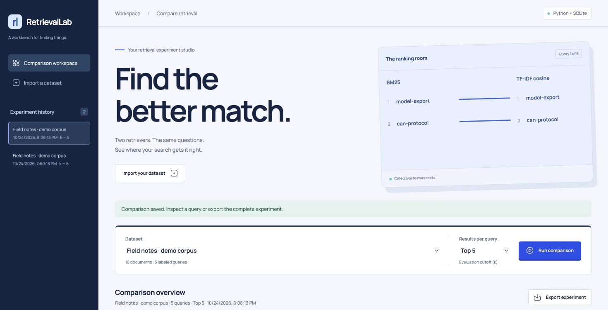

# RetrievalLab

A local web workbench for comparing BM25 and TF-IDF retrieval against your own
relevance judgments. Import documents and labeled questions, run both baselines,
and inspect the evidence behind every score.



## What works

- Import a dataset by pasting JSON or choosing a file, with schema validation.
- Compare BM25 and TF-IDF cosine at k = 3, 5, 10, or 20.
- Inspect precision, recall, reciprocal rank, and binary nDCG, averaged across queries.
- Switch queries to inspect ranked passages and a diagram connecting shared results.
- Reopen experiments saved in SQLite, including after restarting the app.
- Export the complete dataset, labels, parameters, version, SHA256, and measured results.
- Run an evaluation from the command line without opening the browser.

## Run

Python 3.10+ is sufficient. No Python runtime packages, account, model download,
or API keys are required. All fonts, icons, and motion assets are served locally.

```sh
git clone https://github.com/ryanfer123/RetrievalLab.git
cd RetrievalLab
python3 -m retrieval_lab
```

Open **http://127.0.0.1:8765**. Click **Try the demo corpus**, then **Run comparison**.
The bundled demo contains ten hand-authored documents and five labeled questions;
its scores demonstrate the workflow, not general retrieval quality.

Use another port or database when needed:

```sh
python3 -m retrieval_lab --port 8790 --database experiments.sqlite3
```

The app binds to `127.0.0.1`, validates the Host header, and rejects cross-origin
writes. It is a single-user local application. It has no account system, tenant
isolation, or internet deployment configuration. SQLite data stays on the machine;
exports contain the imported text, so review them before sharing.

## Import your own corpus

```json
{
  "name": "Battery documentation",
  "documents": [
    {"id": "d1", "text": "Battery health depends on cycle count and internal resistance."},
    {"id": "d2", "text": "CAN frames carry telemetry between controllers."}
  ],
  "queries": [
    {"id": "q1", "text": "battery cycle count", "relevant_ids": ["d1"]}
  ]
}
```

IDs must be unique strings within their collection. Each query needs at least one
relevant document that exists in the corpus. Imports allow up to 1,000 documents,
100 queries, 10,000 characters per text, and 2 MiB total per request. Labels are
binary; a document either is relevant or is not. The importer normalizes relevance
ID order before storing the dataset and computing its hash.

## Reproduce an experiment in the terminal

```sh
python3 -m retrieval_lab --evaluate retrieval_lab/web/demo.json --k 3 --output run.json
```

Re-run an exported experiment by extracting its `dataset` member to a JSON file
and using the same `k`. Rankings, metrics, and dataset hashes are deterministic
for the same data, configuration, and software version. UUIDs, timestamps, and
latency measurements vary. The export records configuration explicitly.

## Retrieval and metric definitions

| Component | Definition |
| --- | --- |
| Tokenizer | Unicode words, case folding, no stemming or stopword removal |
| BM25 | k1 = 1.5, b = 0.75; IDF = ln(1 + (N - df + 0.5) / (df + 0.5)); query terms treated as a set |
| TF-IDF | TF = 1 + ln(count); IDF = ln((N + 1) / (df + 1)) + 1; cosine similarity |
| Ties | Document ID ascending; zero-score documents omitted |
| Precision@k | Relevant hits divided by k, even when fewer than k documents are returned |
| Recall@k | Relevant hits divided by the number of judged relevant documents |
| MRR@k | Mean reciprocal rank of the first relevant result within k |
| nDCG@k | Binary gain, log2 rank discount, normalized by the ideal ranking |
| Mean latency | Search-call time, excluding index construction, database and network time |

The rank diagram shows up to three returned documents per retriever. A line
connects the same document across both lists. Full ranked passages are below it.
Scores from the two algorithms are not directly comparable. This is lexical
retrieval evaluation; the app does not measure generated-answer correctness.

## Validate and build

```sh
python3 -m unittest discover -s tests -v
python3 -m pip wheel . --no-deps -w dist
```

The suite covers reference calculations, deterministic ties, out-of-vocabulary
queries, input validation, import/run/export persistence, loopback restrictions,
and HTTP failures. GitHub Actions runs it on Python 3.10, 3.12, and 3.13.

The frontend has no compilation step. Authored files live in `retrieval_lab/web/`;
the wheel includes both these files and the vendored browser assets. GSAP animates
introductory text and ranking connections; Lenis is the only smooth-scroll engine.
Reduced motion bypasses both effects. Three.js is deliberately omitted because
ranked evidence is clearer as a lightweight SVG data graphic.

[Validation evidence](docs/VALIDATION.md) records checks and boundaries.
[Asset provenance](THIRD_PARTY.md) lists exact versions and licenses.
[Contributing](CONTRIBUTING.md) explains the development contract.

## License

MIT for application source. Bundled fonts, icons, and libraries retain their own
licenses; see [THIRD_PARTY.md](THIRD_PARTY.md).
